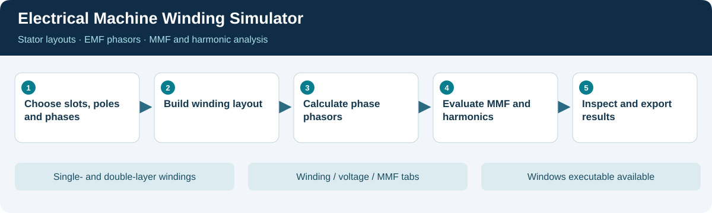
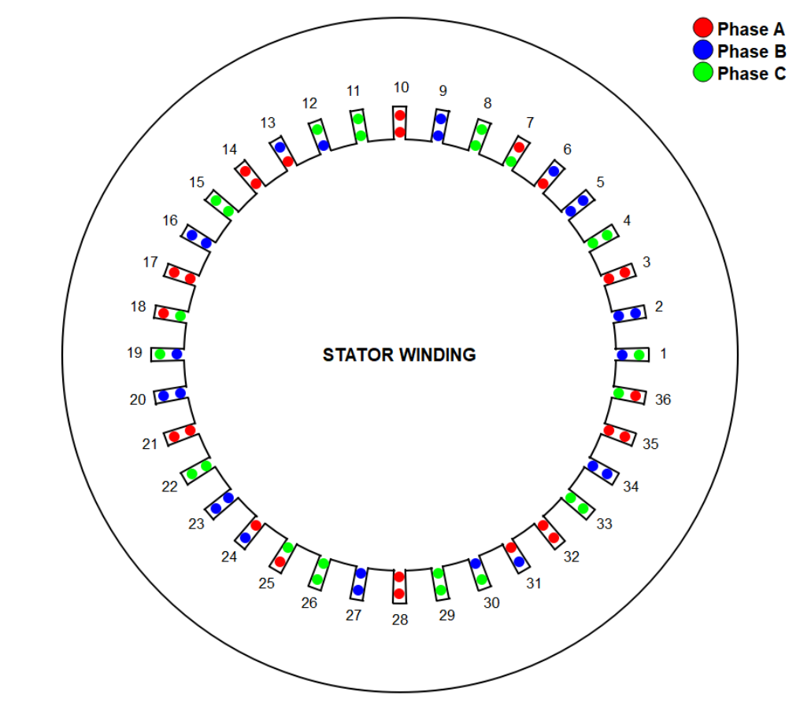
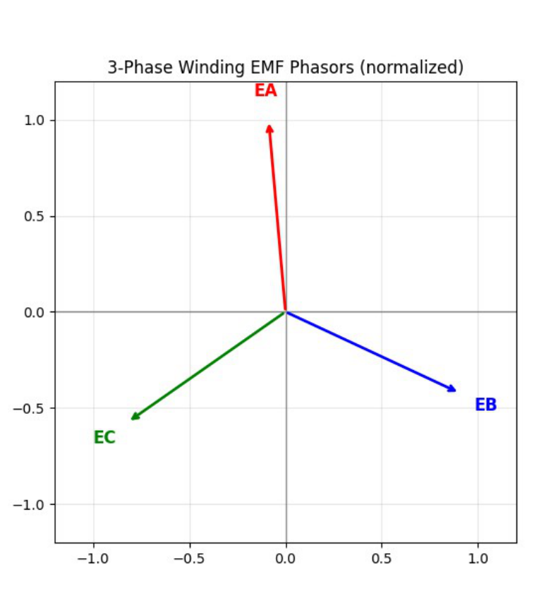
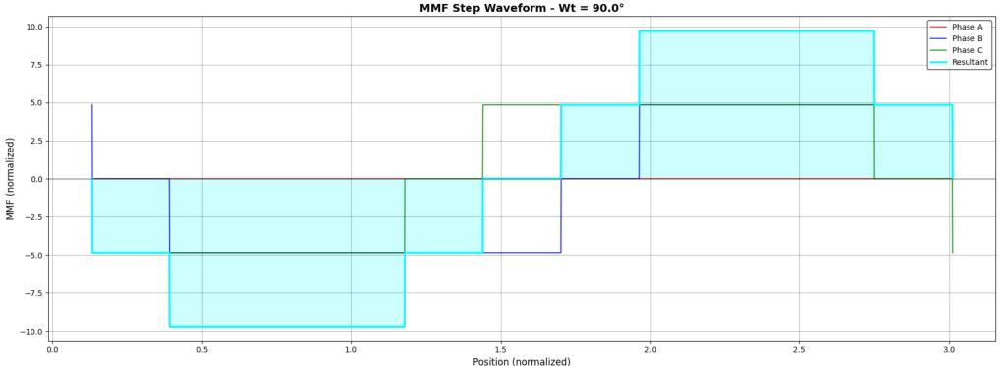

# Electrical Machine Winding Simulator

**Stator layouts · EMF phasors · MMF and harmonic analysis**

A Windows desktop application for designing and visualizing multiphase AC-machine stator windings. It connects the physical slot arrangement to winding factors, induced-voltage phasors and magnetomotive-force distributions.

Academic group project at the National Polytechnic School of Algiers.

## Explore the winding as a complete system

| View | What it explains |
|---|---|
| Stator layout | Which slots belong to each phase and how coils are arranged |
| Winding factors | How coil pitch and distribution affect the resultant phase voltage |
| EMF phasors | How slot contributions combine into phase voltages |
| MMF distribution | How the winding and instantaneous phase currents create a spatial field |
| Harmonic analysis | Which spatial components are present in the selected winding |
| Spreadsheet export | Calculation data for further study |

## The key geometric quantities

For $Q$ slots, $m$ phases and $p$ pole pairs, slots per pole per phase are:

$$q=\frac{Q}{2pm}$$

The electrical angle between adjacent slots is:

$$\alpha_e=\frac{2\pi p}{Q}$$

The phase winding factor describes how the slot-voltage phasors add. Coil distribution and coil pitch determine the magnitude of this sum. Changing the winding layout therefore changes both the useful fundamental component and the harmonic content.

## Worked examples from the report

### Stator winding layout

This three-phase, 36-slot, five-pole-pair double-layer example has $q=1.2$. It illustrates a fractional-slot arrangement rather than requiring an integer number of slots in every pole/phase group.

### Phase EMF phasors

The normalized phasors make the phase relationships visible and connect the slot arrangement to the resultant induced voltages.

### Resultant magnetomotive force

This figure uses a three-phase, 12-slot, one-pole-pair double-layer example at an electrical angle of 90°. The individual phase contributions combine into the resultant spatial MMF. The [technical report](docs/winding-of-ac-machines-report.pdf) develops the examples and harmonic calculations.

## Why these interface choices

The Winding Simulator, Voltage Checker, and MMF and Harmonics tabs follow the same chain as the engineering calculation: geometry first, voltage addition second, magnetic-field distribution third. Keeping the views together makes it easier to see how a geometric choice affects electrical and magnetic behavior.

## Download and run

**[Download Winding Simulator for Windows](https://github.com/MouaadO/electrical-winding-simulator/releases/latest/download/Winding_Simulator.exe)**

1. Download and open `Winding_Simulator.exe`.
2. Choose the slot, pole and phase configuration.
3. Inspect the winding layout and phase-voltage relationships.
4. Use the MMF and harmonic views to study the selected configuration.
5. Export the calculation data when needed.

The executable includes its Python runtime. The repository contains the report and worked-example figures; the Windows app is distributed through GitHub Releases.

## Tools and documents

**Application stack:** Python, PyQt5, NumPy, pandas, Matplotlib, openpyxl and PyInstaller.

| Location | Contents |
|---|---|
| [Latest release](https://github.com/MouaadO/electrical-winding-simulator/releases/latest) | Windows application |
| [Technical report](docs/winding-of-ac-machines-report.pdf) | Winding theory, fractional-slot examples, MMF and harmonics |
| `docs/results/` | Layout, phasor and MMF figures |

## Related projects

[Permanent Magnet Synchronous Generator](https://github.com/MouaadO/permanent-magnet-generator) · [Induction Motor Direct Vector Control](https://github.com/MouaadO/induction-motor-vector-control)
