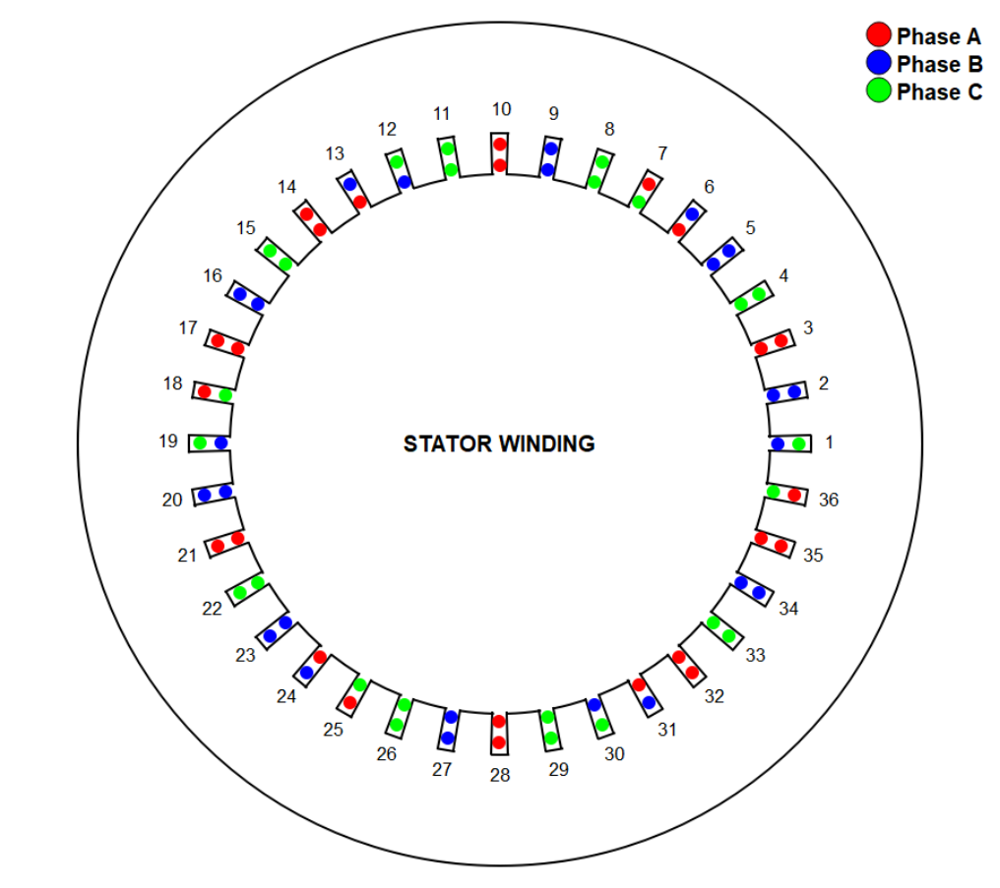
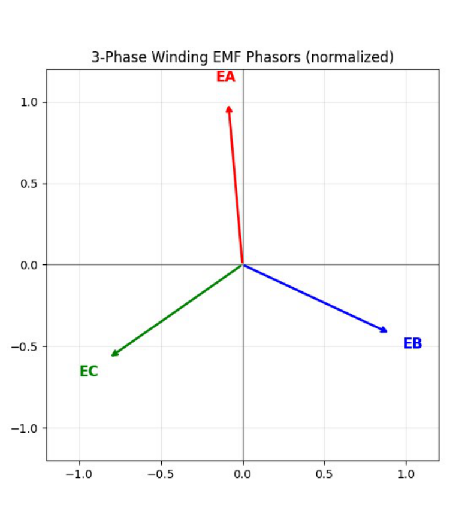
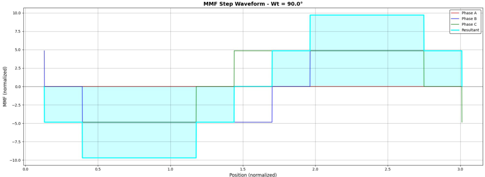

# Electrical Machine Winding Simulator

A Python desktop application for designing and visualizing multiphase AC-machine stator windings. It connects winding layouts with EMF phasors, magnetomotive-force distributions and harmonic analysis.

## What it does

- Generates single-layer and double-layer winding patterns from slot, pole and phase parameters.
- Draws stator layouts and winding connections.
- Calculates winding factors and visualizes phase EMF relationships.
- Evaluates MMF distributions and harmonics for selected current and winding settings.
- Exports calculation data to spreadsheets.

## Results

Figures from the [Winding of AC Machines report](docs/winding-of-ac-machines-report.pdf).

### Stator winding layout

A three-phase, 36-slot, five-pole-pair double-layer example.



### EMF phasors

The normalized phasors show the phase relationship for the reported winding example.



### Magnetomotive force

Reported MMF profile for the three-phase, 12-slot, one-pole-pair double-layer example at an electrical angle of 90 degrees.



## Tools

Python 3, PyQt5, NumPy, pandas, Matplotlib and openpyxl. Pillow supports icon creation; PyInstaller supports Windows packaging.

## Run

```bash
python -m pip install -r requirements.txt
python main.py
```

Explore the Winding Simulator, Voltage Checker, and MMF and Harmonics tabs. To build a Windows application, install PyInstaller and run `pyinstaller winding_simulator.spec`.

## Project files

| File | Purpose |
| --- | --- |
| `main.py` | Desktop application entry point |
| `Winding_tab.py`, `StatorDrawing.py` | Winding controls and stator drawing |
| `winding_pattern_matrix.py`, `explanation.py` | Winding-pattern calculations |
| `Voltage_tab.py` | Voltage analysis |
| `MMF_Harmonics_tab.py`, `mmf_calculation_engine.py` | MMF and harmonic analysis |
| `requirements.txt` | Runtime dependencies |
| `winding_simulator.spec` | Windows build configuration |

## Technical report

[Read Winding of AC Machines](docs/winding-of-ac-machines-report.pdf) for winding theory, worked examples, fractional-slot windings, MMF calculations and harmonic analysis.

Developed as a collaborative academic engineering project.
